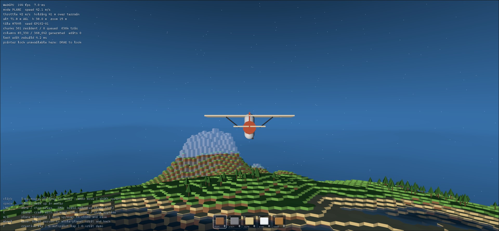
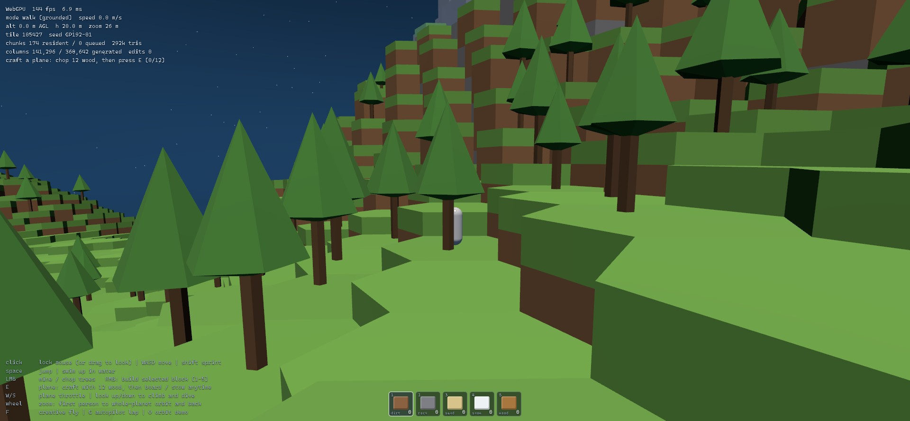

# Goldberg Planet

**Play it: <https://matthew-kissinger.github.io/goldberg-planet/>**

A small browser game on a spherical planet whose surface is a true Goldberg polyhedron
(hexagons plus exactly twelve pentagons). The loop is one sitting long: walk the hex planet,
chop trees for wood, craft a wooden bush plane from 12 wood, and fly it around the world,
from a footstep in a clearing to the whole planet hanging in space. The topology is derived
from scratch: combinatorial tile ids stitched across 20 icosahedral charts, no geometry
library ([Shape and identity](#shape-and-identity)).

Best in a WebGPU browser (Chrome/Edge); it falls back to WebGL2 automatically everywhere else.
Phones get touch controls automatically, and a standard gamepad drives the whole loop.

| | | |
|---|---|---|
|  |  |  |
| the wooden plane you craft | forests grow from the same seed | the whole planet in frame |

This is a deliberately small slate. An earlier, much larger survival-builder cycle
("Hearth and Horizon": building kits, fishing, cooking, caves gameplay, weather, creatures,
pentagon landmarks) was burned down to this loop on 2026-10-26; its docs live in
[docs/archive/](docs/archive/).

## Run locally

```
npm install
npm run dev      # open the printed URL
npm test         # topology, world, trees, crafting, drops, save, input, character tests
npm run build    # typecheck + production bundle (deployed to Pages by CI)
```

URL params: `?seed=anything` (world seed), `?m=192` (Goldberg frequency), `?gpu=gl` (force
the WebGL2 fallback), `?touch=1` (force the touch UI), `?clouds=0` (no cloud layer),
`?skyq=low|high` (sky march quality; defaults low on coarse-pointer devices), `?debug=1`
(start with F3 diagnostics open), `?nosave=1` (no local save), `?reset=1` (clear this
seed's save slot before boot), `?mute=1` (start muted), `?plane=1` (start with the plane
already crafted).

## The loop

1. **Chop.** Aim at a tree and swing. Each tree takes four hits; the trunk cracks as it
   takes damage, then it falls and drops 6 wood as loose logs.
2. **Pick up.** Walk onto or next to the logs; after a short settle they fly into your pack.
   Two trees is enough.
3. **Craft.** Open crafting and build the **Plane Frame** (12 wood), or just press the plane
   key with 12 wood and it crafts and boards in one step.
4. **Fly.** Throttle with forward/back and steer by looking. Touching ground, water, or a
   cliff stows the plane; the plane key brings it back.

Progress (player, wood, plane, felled trees, loose logs) autosaves to `localStorage` per
seed and frequency.

## Controls

| | Keyboard + mouse | Touch | Gamepad |
|---|---|---|---|
| Move / throttle | WASD (Shift sprints) | left stick (push past the rim to sprint) | left stick (full tilt or RB sprints) |
| Look / steer | mouse (pointer lock, or drag) | drag | right stick |
| Zoom (first person to orbit) | wheel | pinch | LB + right stick |
| Jump / climb, descend | Space, Ctrl or C | ▲ ▼ buttons | A, LT |
| Chop | left click (hold to keep swinging) | tap the tree | X or RT |
| Crafting panel | B (Esc closes) | craft button | Y (A crafts, B closes) |
| Craft + board / stow plane | E | plane button | Start |
| Free-flight (dev) | F | | |
| Mute, stats, help | N, F3, H | | Back+LB, R3+LB, R3 |

## The plane

Velocity chases wherever you look, forward/back set the throttle, and, the part that makes
it feel like flying around a *planet*, **flying level holds your altitude above the ground,
not above sea level**. The flight model samples the column field under you and ahead of you,
so rising terrain lifts you over ridgelines and falling terrain lets you sink back down the
far side, all the way around the sphere.

## Code map

- `src/main.ts`: boot behind the splash, then the frame loop (input, player, camera,
  streaming, chopping, save, HUD, render).
- `src/game/`: the loop itself. `coreLoop.ts` (inventory, chop, pickup, craft, board),
  `controls.ts` (keyboard/touch/gamepad merged into one per-frame intent), `cameraRig.ts`
  (ground-to-orbit camera), `autosave.ts`, `spawn.ts`, `hints.ts` (per-device copy).
- `src/sim/`: pure rules. `crafting.ts`, `resourceDrops.ts`, `save.ts`, `equipment.ts`
  (character action and held item).
- `src/world/`: Goldberg tiles to terrain. Layers, terrain noise, columns (with natural cave
  voids carved into the terrain), trees, chunk streaming, and ray picking.
- `src/render/`: chunk mesher, far sphere, ocean, sky and clouds, stars, character and
  plane, loose-log drops, tile highlight.
- `src/player/`: player physics and the raw input devices.

`window.render_game_to_text()` returns a read-only JSON snapshot (mode, inventory, target,
nearest tree bearing, plane state) for automated playtests.

## Shape and identity

- Tile ids are **combinatorial, not spatial**: icosa **vertex** (12), icosa **edge** +
  offset, or icosa **face** + interior (i,j), an atlas of 20 charts stitched by canonical
  ownership of shared features. No global coordinate chart exists in addressing, which is
  why the twelve pentagons are unremarkable: they're just the degree-5 ids. Neighbor lists
  are explicit and CCW-ordered ([goldberg.ts](src/geo/goldberg.ts)).
- **GP(192,0)** at a **900 m radius**: 368,642 tiles (~5.2 m across), 12 of them pentagons.
- Every tile carries position, boundary polygon, ordered neighbors, and an oriented local
  frame; trees reuse that frame, so the mesher and the chop-picker agree on where a trunk is.
- **Watertight by construction**: a shared corner is the normalized centroid of the three
  owning tile centers summed in ascending-id order, bit-identical floats from all sides,
  asserted by test.

## Volume and terrain

- One **global radial layer grid**: 148 uniform 1.25 m cells spanning +130…−55 m around sea
  level, then ×1.5 growth per layer to a single bedrock cell, **163 layers**, so resolution
  decays with depth and storage is O(tiles), never O(R³).
- Columns are bitmask runs, so overhangs and the natural arches and caves carved by the
  terrain generator work. The column store still supports per-cell edits (tested), but the
  game no longer exposes mining or building.
- Picking ray-marches the same column field the mesh is built from (trees get an exact
  ray-vs-axis test against their deterministic placement); collision reads columns too, so
  physics works even where meshes aren't resident.

## Streaming and rendering

- ~1,800 chunks of ≤ ~256 tiles stream inside an angular cap sized to the peak-visibility
  horizon, with hysteresis and a per-frame build budget. **Trees are meshed into their
  chunk's buffers**: they stream, release, and rebuild with the chunk, zero extra draw calls.
- The **far view** is a frequency-96 geodesic sampling the same terrain field, sunk 6 m,
  always resident; triangles covered by resident chunks are filtered from its index. The
  **water** is an order-7 geodesic whose per-vertex shore depth is sampled from the
  layer-quantized surface, so the depth tint and foam band hug the hex terraces.
- The **sky is raymarched**: an exponential atmosphere shell with day/night scattering and
  **voxel clouds** in a band 120–165 m up, both clamped against the scene depth buffer.
- **Camera**: floating origin (f64 sim, camera pinned at 0,0,0); one continuous zoom axis
  from first person to orbit; the third-person boom ray-casts the column field and pulls in
  ahead of terrain; pull-back turns radial so orbit sits directly above you.
- **WebGPU first** via `three/webgpu` (r185); automatic WebGL2 fallback (`?gpu=gl`).
- Gravity pulls toward the core; "up" is the local radial normal; heading is a
  parallel-transported tangent, so there are no poles and no gimbal lock, pentagons included.

## QA and deployment

- Local gates: `npm test` and `npm run build`.
- Browser QA: spawn, chop two trees to 12 wood, craft the plane, board and fly, on desktop
  and on a phone viewport with `?touch=1`, with no console errors.
- Production build uses Vite `base: './'`, so the same `dist/` works under
  `https://matthew-kissinger.github.io/goldberg-planet/` and local static preview paths.
- GitHub Pages deploys on push to `main` via `.github/workflows/deploy.yml`. The app is
  static: no server, secrets, or runtime API keys.

## Honest limitations

- Tree trunks have no collision; you walk through them.
- Trees don't render into the far-view proxy, so a distant ridge gains its forest as you
  approach.
- Beach tiles step ~0.35 m above the water plane; the far sphere sits 6 m low, so
  partially-covered coastal triangles at the residency boundary can peek through far away.
- Collision is a column-sampled point capsule (step-up, head bump, wall block), not a swept
  hull.
- The character is procedural and chops with bare hands; there is no axe model.
- The soundtrack ("The Twelve Bells", see `public/audio/music/MUSIC.md`) predates the
  burndown and still names the old pentagon domains.

## License

MIT. See [LICENSE](LICENSE).
